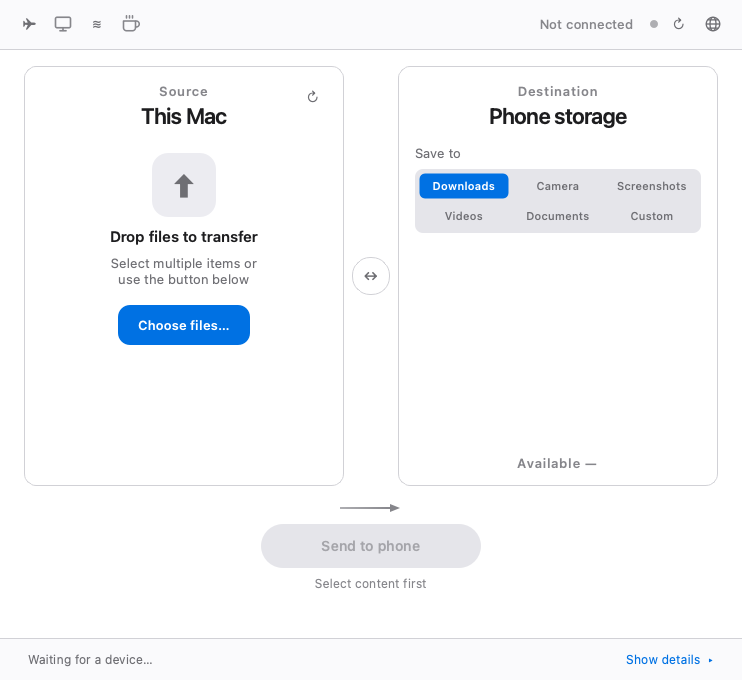
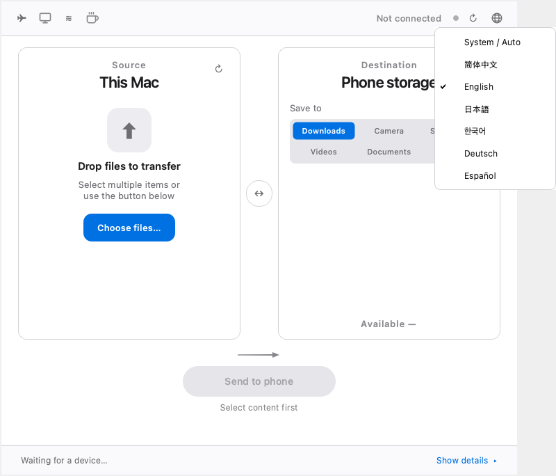

# PhoneTransfer 📱 ⇄ 💻

[English](README.md) | [简体中文](README.zh-CN.md)

An open-source macOS utility for bidirectional Android file transfers over **ADB**, with file browsing, Quick Look, clipboard sending, wireless connections and optional screen mirroring. No permanently installed companion APK is required.

**Latest download (v1.1.0):** [PhoneTransfer-v1.1.0-macOS.dmg](https://github.com/qfxydx/PhoneTransfer/releases/download/v1.1.0/PhoneTransfer-v1.1.0-macOS.dmg) · [Release notes](https://github.com/qfxydx/PhoneTransfer/releases/tag/v1.1.0) · [简体中文](README.zh-CN.md)

**New in v1.1.0:** six interface languages (简体中文 / English / 日本語 / 한국어 / Deutsch / Español), a small globe-only language menu, bilingual documentation, and localized diagnostics. The installer is **ad-hoc signed, not Apple Developer ID signed or notarized**; macOS may require manual approval. ADB is required separately.

## Screenshots

**v1.1.0 language interface** (mocked UI screenshots, not physical-device tests):

| English interface | Language menu |
| --- | --- |
|  |  |

**File management and tools:** these older feature screenshots remain for reference; the v1.1.0 top toolbar now uses a globe icon.

| Mac → Phone | Phone → Mac / file browsing |
| --- | --- |
|  |  |
| Clipboard / quick text | Wireless connections |
|  |  |

Further mocked screenshots and validation details: [i18n implementation report](docs/i18n-v1.1.0-report.md).

## Features

- **Bidirectional files and folders:** drag files from Mac to Android, or browse shared storage and select files to download to Mac. Switch devices from the top right when several are connected.
- **Verified transfers:** single-file uploads and downloads use sibling temporary files and SHA-256 verification before replacement. Cancellation and failures preserve the original destination; temporary files created by that operation are cleaned up.
- **File-level retry:** folder transfers can skip files already verified as identical. This is **not block-level resume** within an incomplete file.
- **Conflict handling:** replace existing files or keep both with numbered names. Available storage is displayed before transferring.
- **Browsing and management:** quick folders, search, category filters, new folders, rename and permanent deletion inside shared storage. Confirm the target device and paths before deleting or replacing anything.
- **Quick Look:** press Space on a selected file. Images, PDFs, text and other supported documents use macOS Quick Look; audio/video use a Qt media window. Phone previews are downloaded into a cache isolated by device and checked against file metadata. Large videos may take time to download; playback depends on system codecs.
- **Text, URLs and clipboard:** send Unicode text, line breaks and emoji to the phone clipboard, open URLs in its browser, or save text as a UTF-8 note in `/sdcard/Download`. Support varies by Android version and vendor ROM.
- **Optional scrcpy integration:** launch screen mirroring/control using the currently selected device and ADB installation. Install scrcpy separately. Clipboard synchronization and input support depend on scrcpy and the device.
- **USB and wireless ADB:** Android 11+ pairing codes, manual IP/port connections and classic USB-to-TCP mode on port 5555, with explicit safety confirmation and a separate disable action.
- **APK installation:** add an `.apk` file and choose installation or file transfer. Installation uses normal update mode (`-r`); it does not silently permit downgrades or test-only packages (`-t`). Install only APKs from trusted sources. Removing an old app to resolve a signature conflict may remove its data.
- **Six interface languages:** `zh-CN`, `en`, `ja`, `ko`, `de`, `es`, using centralized UTF-8 catalogs. Technical tokens, filenames, paths and external error output are preserved.

PhoneTransfer uses ADB; **MTP is not supported**.

## Language selection

A small globe icon at the upper right opens the interface-language menu when clicked. The main window shows only the icon, with no current-language name or abbreviation. The menu offers **System / Auto** plus 简体中文, English, 日本語, 한국어, Deutsch and Español, with the saved choice checked. The default follows macOS preferred languages: the first supported language is selected, regional variants match their language family, and Chinese variants use Simplified Chinese. If no supported language is found, English is used.

Your selection is stored in macOS preferences using Qt `QSettings` and persists between launches. **Quit and reopen PhoneTransfer after changing it.** Selecting a different option shows a restart reminder; choosing the saved option again does nothing. Running transfers and the current session keep their language until you restart. All windows, worker messages, notifications and Qt standard confirmation buttons then use the selected language. This changes the application's interface language; macOS keyboard/input sources are unaffected. Native macOS panels/Quick Look and OS/ADB/scrcpy diagnostics may follow the system or tool language.

## Installation and prerequisites

### Latest v1.1.0 DMG

1. [Download the v1.1.0 DMG directly](https://github.com/qfxydx/PhoneTransfer/releases/download/v1.1.0/PhoneTransfer-v1.1.0-macOS.dmg) and open it.
2. Drag `PhoneTransfer.app` to Applications.
3. Install ADB separately, enable USB debugging on the phone, then launch the app.

v1.1.0 includes the six-language globe menu and retains the v1.0.2 native file chooser fixes. The app is **ad-hoc signed; it is not signed with an Apple Developer ID or notarized**. Download only from the official project releases. If macOS blocks its first launch, use the normal macOS Privacy & Security approval flow; do not disable system-wide security protections.

**Previous stable release:** [v1.0.2 DMG](https://github.com/qfxydx/PhoneTransfer/releases/download/v1.0.2/PhoneTransfer-v1.0.2-macOS.dmg) · [Release history](https://github.com/qfxydx/PhoneTransfer/releases).

### Dependencies

- macOS 11 or later; Python 3.10+ for source execution.
- PySide6 6.5+ (installed through `requirements.txt`).
- **ADB / Android platform-tools must be installed separately**. PhoneTransfer does not bundle ADB or scrcpy. The app searches PATH and common Android SDK/Homebrew locations.
- Optional: scrcpy for screen mirroring; Homebrew is needed only for the commands below or the in-app installation shortcut.

```bash
brew install android-platform-tools
# Optional:
brew install scrcpy
```

### Prepare the phone

Enable Developer options (usually by tapping Build number repeatedly), then enable **USB debugging**. Connect a data-capable USB cable and approve this Mac on the phone. Only approve computers you trust; persistent authorization is optional. Settings names vary across devices.

ADB debugging grants broad access to the device. Disable debugging and revoke unused computer authorizations when appropriate. Android versions, vendor security policies, ROMs and filesystem permissions differ; compatibility with every device is not guaranteed.

### Run the current source

```bash
git clone https://github.com/qfxydx/PhoneTransfer.git
cd PhoneTransfer
python3 -m venv .venv
source .venv/bin/activate
python3 -m pip install -r requirements.txt
python3 phone_transfer.py
```

The repository's `启动PhoneTransfer.command` is another source launcher. The native Mac chooser uses `bin/pick_items`. If rebuilding that helper is necessary, install Xcode Command Line Tools and run:

```bash
swiftc -O -o bin/pick_items pick_items.swift
```

You can also drag files into the app. Missing or failing helper errors are shown in the selected language. PyInstaller's [spec file](PhoneTransfer.spec) includes the language catalogs alongside other application assets; this task has not rebuilt an installer. Existing release archives must not be overwritten.

## Clipboard helper and wireless security

Clipboard actions may push the open-source `pt_clip.jar` into `/data/local/tmp/` and execute it with ADB shell privileges. The helper process exits after the action, but the **JAR can remain on the phone and be reused** after hash checking. It is not a permanently running APK. Do not send secrets to devices you do not trust. Source and rebuild instructions: [ClipTool](tools/cliptool/README.md), [Java source](tools/cliptool/src/com/phonetransfer/clip/ClipTool.java), [build script](tools/cliptool/build.sh).

Prefer Android 11+ **pairing-code wireless debugging**. Classic TCP ADB on **5555** is for temporary use on trusted private networks only. Unplugging USB, quitting PhoneTransfer or running `adb disconnect` does **not** guarantee that the phone stops listening. Select the connected `IP:5555` device and use the dialog's disable action; if shutdown cannot be confirmed, connect USB and run `adb usb`, or disable debugging in the phone's Developer options. Never expose debugging to untrusted networks.

Back up important data. Validate a transfer with nonessential files before relying on a new device/ROM combination. Deletion is permanent and APK installation may change apps and their data. Automated tests do not constitute exhaustive real-device testing.

## Keyboard shortcuts

| Shortcut | Action |
| --- | --- |
| Space | Toggle preview for the selected file |
| `⌘⇧V` (`Ctrl+Shift+V`) | Open quick text / clipboard dialog |
| `⌘⇧M` (`Ctrl+Shift+M`) | Launch scrcpy mirroring |
| `⌘↵` | Send from the quick text dialog |
| Esc | Clear a filter or navigate up, depending on focus |

## Development and tests

```bash
python3 scripts/run_tests.py
python3 -m compileall -q phone_transfer.py phonetransfer tests scripts
# Optional: regenerate the mocked UI evidence without connecting a phone
python3 scripts/capture_i18n.py
```

The runner sets the original regression tests' diagnostic language to Chinese and runs all safety and six-language tests offscreen. Device operations are mocked; tests must not access or delete real device files. Translation keys, parameter names/conversions, preferences, fallback, restart behavior, standard buttons, shortcuts and longer layouts are checked. See [the evidence report](docs/i18n-v1.1.0-report.md) for exact results and limits.

Catalog maintenance instructions: [phonetransfer/locales/README.md](phonetransfer/locales/README.md). The native file chooser source is [pick_items.swift](pick_items.swift).

## Issues, contributions and support

Please report bugs in **English or Chinese** using the [bilingual issue template](.github/ISSUE_TEMPLATE/bug_report.md) at [GitHub Issues](https://github.com/qfxydx/PhoneTransfer/issues). Include the app version or source SHA, selected UI language, macOS/CPU, Android model/version/ROM, connection method, reproduction steps and sanitized logs/screenshots. For translation issues, include the language, current wording and suggested wording. The template uses the existing `bug` label; maintainers can categorize translation reports without requiring new remote labels.

Remove personal file contents, paths, serial numbers, private IPs, credentials and ADB authorizations before sharing logs. Contributions are welcome. Use the app's coffee button to support development via WeChat Pay/Alipay, or give the project a GitHub star.

Licensed under [MIT](LICENSE).
