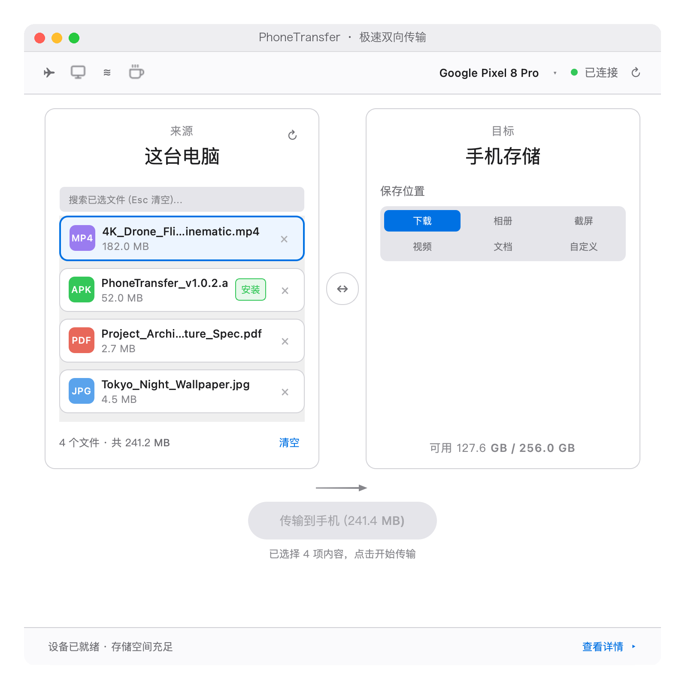
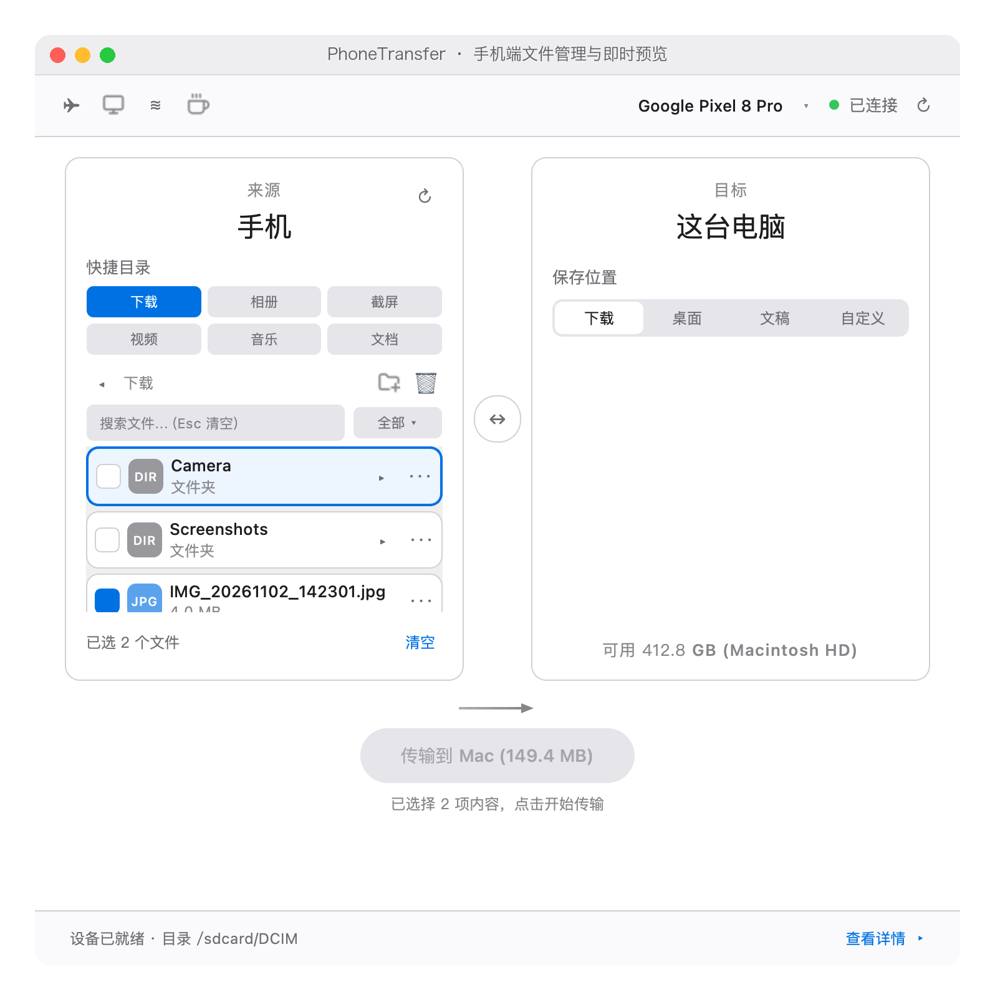
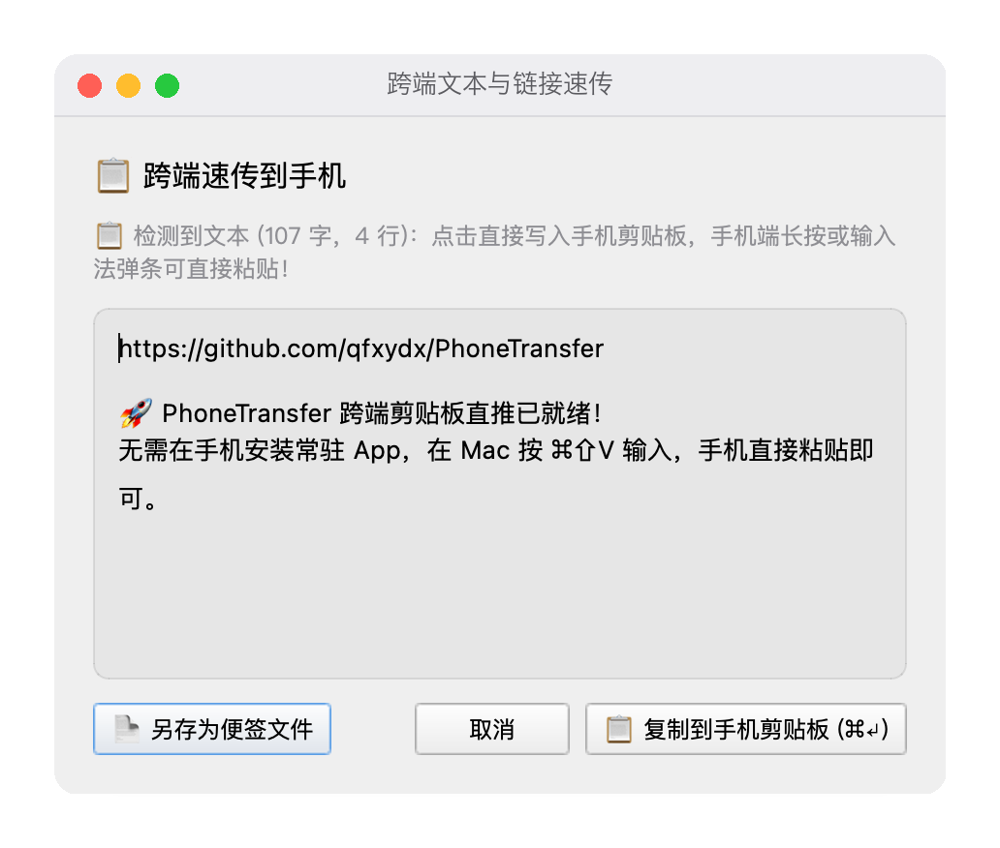
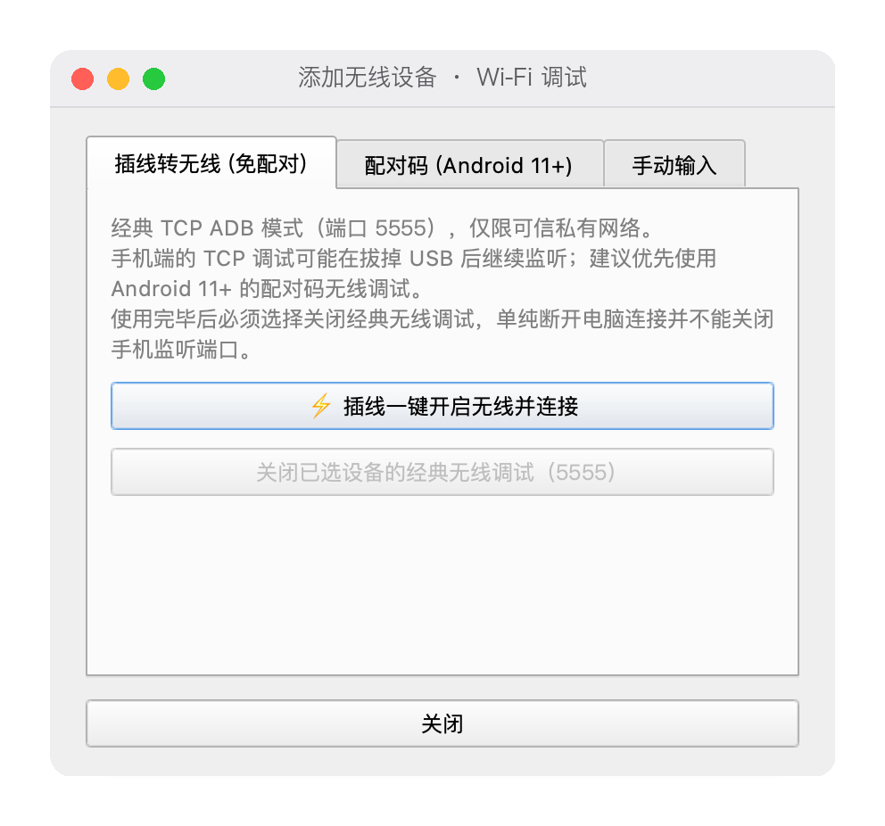

# PhoneTransfer 📱 ⇄ 💻

<p align="center">
  <b>面向 macOS 的 Android 文件传输与跨端协同工具，无需在手机安装常驻 App</b>
</p>

<p align="center">
  <a href="https://github.com/qfxydx/PhoneTransfer/releases/download/v1.0.2/PhoneTransfer-v1.0.2-macOS.dmg"></a>
  <a href="https://github.com/qfxydx/PhoneTransfer/releases/tag/v1.0.1"></a>
  
  
  
  
</p>

<p align="center">
  
</p>

---

## 💡 为什么需要 PhoneTransfer？

在 macOS 上管理 Android 手机文件常受制于 MTP 协议的并发限制或官方工具停更维护。许多第三方工具则要求在手机端常驻安装后台 APK，容易受系统节电策略影响或增加系统负担。

**PhoneTransfer** 基于成熟的 **Android Debug Bridge (ADB)** 协议实现 macOS 与 Android 之间的双向文件管理，无需在手机端安装常驻应用，提供轻量快捷的跨端协同体验：
- **无常驻后台**：手机端无需安装驻留 App，即插即用，拔线即走；
- **跨端辅助集成**：集成本地/远程双向文件管理、空格键快速预览、系统剪贴板速传、无线调试以及屏幕投屏协同；
- **原生 macOS 质感**：采用符合 macOS 人机交互习惯的界面与快捷键设计。

> *注：虽然手机端无需安装常驻 APK，但在执行剪贴板速传时，本工具会通过 ADB 临时向手机 `/data/local/tmp/` 目录推送开源轻量辅助组件 `pt_clip.jar` 并通过系统 Shell 权限反射执行，执行完毕即退出。*

---

## 📸 界面预览与功能展示

| 电脑向手机传输 (Mac → Phone) | 手机文件管理与即时预览 (Phone → Mac) |
| :---: | :---: |
|  |  |
| **跨端文本与剪贴板速传 (`⌘⇧V`)** | **无线连接与管理 (Wi-Fi 调试)** |
|  |  |

---

## 🌟 核心功能特点

### 1. ⚡ 安全双向文件传输
- **传输安全保护**：单文件上传与下载均采用同级临时文件过渡，并在提交前进行端到端 **SHA-256 校验**；只有哈希验证一致后才执行原子替换，传输取消或异常时自动清理临时文件，保护原文件不被意外损坏。
- **文件级恢复机制**：在重复执行文件夹同步或重试时，系统能够基于远端文件哈希与元数据跳过已校验一致的文件，避免重复传输无变更内容（非文件内块级断点续传）。
- **同名防冲突策略**：支持覆盖同名目标或自动保留两份（增加序号后缀）。
- **存储空间感知**：传输前自动读取手机实际可用存储空间，协助避免存储溢出。

### 2. 👁️ 快速预览 (QuickLook & 媒体播放)
- **多类型即时预览**：在文件列表选中项目后轻按 **`Space`（空格键）** 即可呼出预览。
- **差异化渲染引擎**：
  - 图片、PDF、文本、代码等文件调用 macOS 系统原生的 Quick Look 进行渲染。
  - 音频与视频文件调用内建 Qt 多媒体播放器窗口进行播放。
- **缓存与设备隔离**：手机端文件会按设备序列号拉取到隔离的本地临时缓存中，并校验元数据以防混淆。
- *提示：大型高清视频的预览可能受下载耗时、局域网带宽及系统解码器支持能力影响。*

### 3. 📋 跨端系统剪贴板速传 (`⌘⇧V`)
- 借助开源的 `ClipTool` 辅助工具与 ADB Shell 权限，绕过 Android 系统后台限制，将 Mac 端的文字或链接快速写入手机系统剪贴板。
- 在 Mac 上按下 `⌘⇧V`，输入或粘贴任意中英文字符、换行或 Emoji，按 `⌘↵` 即可推送到手机剪贴板。
- 手机端无需切换应用，直接在目标输入框长按或通过输入法候选条粘贴即可。
- *注：受各厂商 ROM 权限沙箱与 Android 版本安全策略差异影响，部分机型可能存在兼容性差异；源码与构建说明见 [`tools/cliptool/`](tools/cliptool/)。*

### 4. 🖥️ 一键屏幕镜像与协同 (`⌘⇧M`)
- 顶栏一键调用开源项目 `scrcpy` 启动超低延迟投屏，自动复用当前 ADB 实例连接。
- 支持在 Mac 上直接使用键盘打字与鼠标拖拽操作手机屏幕，方便文件传输后的即时校验。
- *注：投屏功能需本地已安装 `scrcpy` 命令行工具。*

### 5. ≋ 多种连接方式与无线管理
- **USB 有线连接**：最稳定、吞吐最高的连接模式，推荐用于大文件批量传输。
- **Android 11+ 官方无线调试**：通过系统「无线调试」界面的配对码（Pairing Code）与随机配对端口安全连接。
- **经典 TCP ADB 模式 (5555 端口)**：支持一键开启无线网络模式，免除频繁插拔。
  - *安全提示：经典 5555 端口模式建议仅在受信任的私有局域网环境中临时使用；`adb disconnect` 仅断开客户端连接，不代表关闭手机端的服务监听。工具内提供了关闭无线调试端口的操作入口，用户亦可在手机开发者选项中随时关闭无线调试。*

### 6. 📂 分类筛选与 APK 管理
- **快速分类过滤**：提供照片、视频、音乐、文档、APK、压缩包等快速分类过滤。
- **APK 安装更新**：拖拽本地 `.apk` 文件至手机窗口，工具执行标准更新安装（`-r` 参数覆盖）。为保障设备安全，默认不允许降级安装或安装测试包（`-t`），安装前请确认 APK 来源安全。

---

## ⌨️ 常用快捷键

| 快捷键 | 功能说明 |
| :--- | :--- |
| **`Space` (空格键)** | 快速呼出/关闭文件预览 (QuickLook / 媒体播放) |
| **`⌘⇧V` (`Ctrl+Shift+V`)** | 呼出跨端文本速传对话框 |
| **`⌘⇧M` (`Ctrl+Shift+M`)** | 启动手机屏幕投屏控制 (依赖 scrcpy) |
| **`⌘↵` (`Cmd+Return`)** | 文本速传弹窗内确认发送到手机剪贴板 |
| **`Esc`** | 清空文件筛选过滤词 / 返回上级目录 |

---

## 🚀 下载与安装指南

### 1. 最新稳定版 DMG 安装包（推荐普通用户）

- **最新安装包直接下载**：**[`PhoneTransfer-v1.0.2-macOS.dmg`](https://github.com/qfxydx/PhoneTransfer/releases/download/v1.0.2/PhoneTransfer-v1.0.2-macOS.dmg)**（~54 MB）
- **发布详情页面**：[PhoneTransfer v1.0.2 Release](https://github.com/qfxydx/PhoneTransfer/releases/tag/v1.0.2)
- **本次修复**：修复 macOS 点击「选择文件…」后可能出现的界面无响应；取消操作不会再次打开文件选择窗口，并加强了文件选择进程退出时的状态处理。
- **安装步骤**：
  1. 下载 DMG 镜像文件后双击打开；
  2. 将 **`PhoneTransfer.app`** 拖拽复制到右侧的 **`Applications`** 应用程序文件夹；
  3. 双击打开即可使用！（若系统提示“无法打开未受信任的开发者”，请在 macOS「系统设置 -> 隐私与安全性」中轻按「仍要打开」即可）。

### 2. 开发者源码运行与历史版本

- **源码运行**：支持直接使用 Python 源码运行体验最新更新（详见下方「源码运行与使用前提」）。
- **历史版本**：[v1.0.1 安全更新（未包含本次文件选择器修复）](https://github.com/qfxydx/PhoneTransfer/releases/tag/v1.0.1) / [v1.0.0 早期版本](https://github.com/qfxydx/PhoneTransfer/releases/tag/v1.0.0)。
- **安装包安全提示**：当前版本尚未通过 Apple Developer ID 签名及公证。仅从本项目 GitHub Release 下载，并按 macOS 系统安全流程确认应用来源；不建议关闭系统整体安全防护。

---

## 💻 源码运行与使用前提

### 系统要求与依赖
- **操作系统**：macOS 11 (Big Sur) 及更高版本
- **Python 环境**：Python 3.10+
- **ADB 工具**：系统环境变量中需包含 `adb` 命令。可通过 Homebrew 安装：
  ```bash
  brew install android-platform-tools
  ```
- **投屏依赖（可选）**：如需使用投屏功能，需安装 `scrcpy`：
  ```bash
  brew install scrcpy
  ```

### 手机端准备工作
1. 在 Android 手机上打开「设置 -> 关于手机」，连续点击「版本号」开启「开发者选项」；
2. 进入「系统与更新 / 更多设置 -> 开发者选项」，开启 **「USB 调试」**；
3. 使用 USB 数据线连接 Mac，手机屏幕将弹出「允许 USB 调试吗？」提示，请勾选 **「一律允许使用这台计算机进行调试」** 并点击确定。

### 快速启动
```bash
# 1. 克隆或下载源码解压
git clone https://github.com/qfxydx/PhoneTransfer.git
cd PhoneTransfer

# 2. 安装 Python 依赖包
pip3 install -r requirements.txt

# 3. 启动应用
python3 phone_transfer.py
```

*提示：在 Finder 中也可以直接双击项目根目录下的 `启动PhoneTransfer.command` 脚本快速启动。*

---

## 🛠️ 底层组件与开源说明

PhoneTransfer 秉承透明可信的开源原则，所有辅助代码均开源并包含在代码库中：

- **Android 剪贴板辅助组件 (ClipTool)**：
  - 源码位置：[`tools/cliptool/src/com/phonetransfer/clip/ClipTool.java`](tools/cliptool/src/com/phonetransfer/clip/ClipTool.java)
  - 构建脚本：[`tools/cliptool/build.sh`](tools/cliptool/build.sh)（支持调用 javac 与 Android SDK d8 重新编译）
  - 架构文档：[`tools/cliptool/README.md`](tools/cliptool/README.md)
- **macOS 文件选择辅助器**：
  - 源码位置：[`pick_items.swift`](pick_items.swift)

---

## 🛡️ 安全与兼容性说明

> **PhoneTransfer 是个人独立开发并维护的免费开源项目。**
>
> 开发过程中已尽可能通过代码审查、自动化测试和 Android 模拟器验证功能的安全性与稳定性。
>
> 由于 Android 系统版本、厂商 ROM、ADB 环境及设备配置存在差异，项目无法保证在全部设备和场景下均无故障。
>
> 建议首次使用时以非重要文件验证传输结果，重要数据提前备份。执行删除、覆盖、重命名、APK 安装等操作前，请确认目标设备及操作内容。
>
> 如遇兼容性问题、异常行为或潜在安全风险，欢迎提交 GitHub Issue，作者将在实际维护能力范围内持续修复和改进。

- **设备与定制 ROM 差异**：不同厂商（如小米、三星、OPPO、vivo 等）的定制系统对后台权限、文件访问和媒体广播的响应行为存在差别，项目未对市场上所有机型开展全量适配测试。
- **数据安全防护**：虽然文件传输增加了临时文件和 SHA-256 完整性校验，但在执行批量删除或目标覆盖等破坏性操作前，请务必确认操作范围。
- **社区协作**：欢迎提交 Pull Request 完善对更多设备与场景的适配支持。

---

## 📮 问题反馈与交流

如果在使用过程中遇到异常错误或兼容性问题，欢迎前往 GitHub Issues 提交反馈：
- **Issue 提交入口**：[GitHub Issues](https://github.com/qfxydx/PhoneTransfer/issues)
- 提交时请使用预设的 **[Bug 反馈模板]**，协助附上操作系统版本、手机型号、定制系统版本及相关错误日志。
- *请注意：提交日志时切勿包含个人文件内容、设备序列号、私有 IP 或凭证等敏感信息。*

---

## ☕ 赞助支持 (Buy Me a Coffee)

PhoneTransfer 由个人在业余时间独立开发并维护。如果它在日常工作中为你提供了便利，欢迎：
- 在应用左上角点击 **`☕`** 请作者喝杯咖啡 🥐
- 在 GitHub 右上角给本项目点一个 **Star ⭐** 支持持续改进！

---

## 📄 开源许可证

本项目采用 [MIT License](LICENSE) 协议开源。
