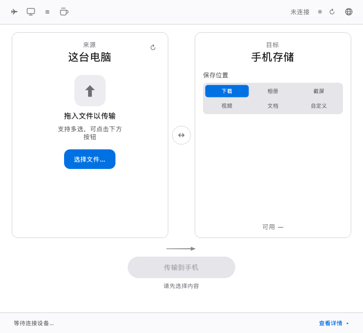
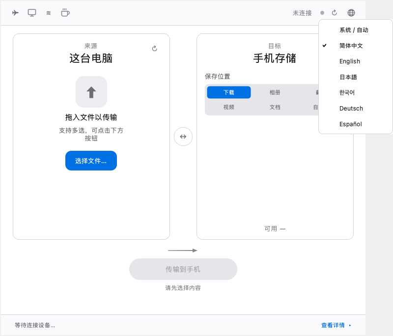
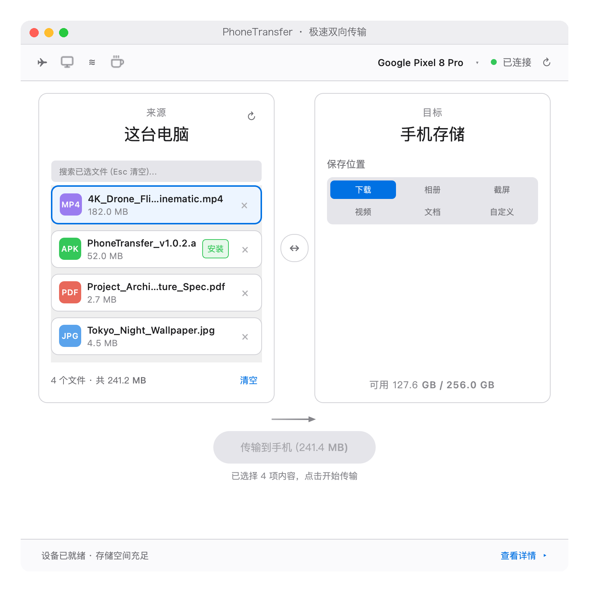
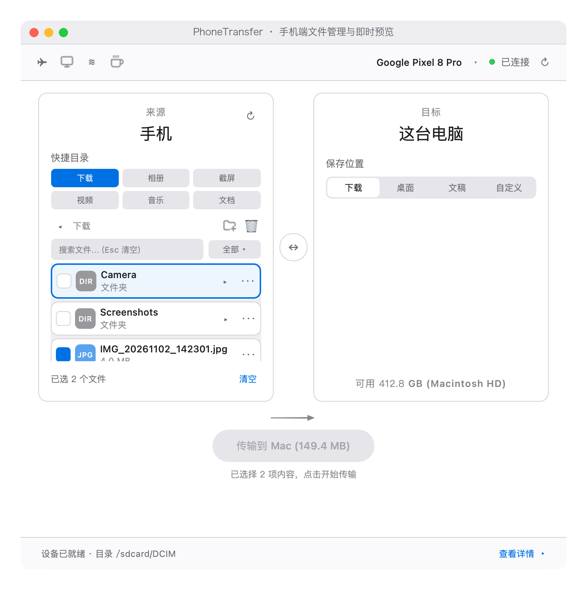
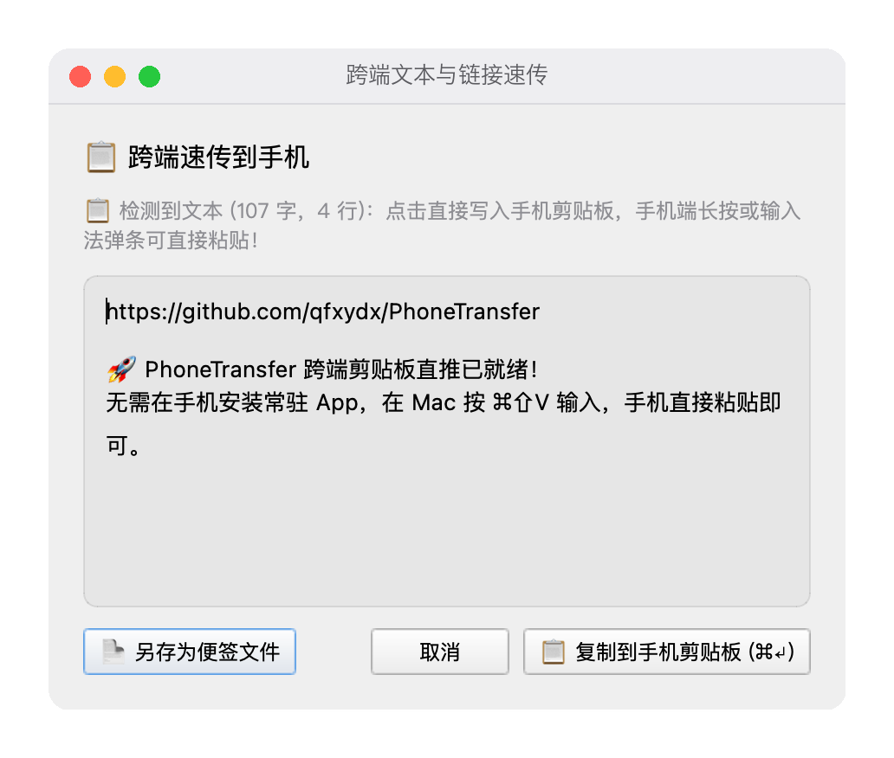
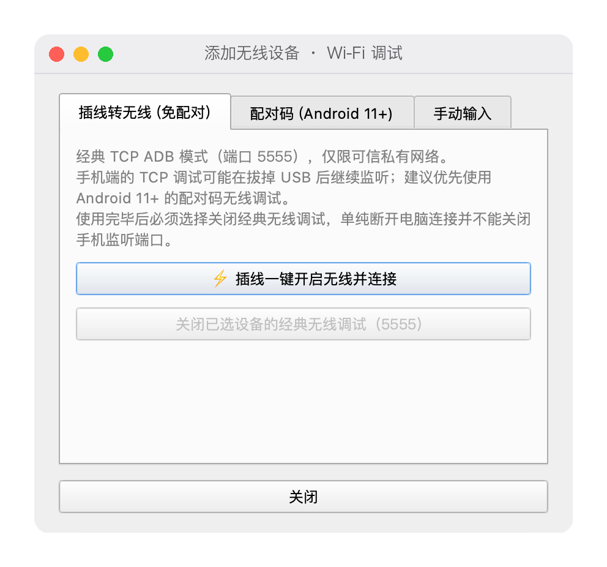

# PhoneTransfer 📱 ⇄ 💻

[English](README.md) | [简体中文](README.zh-CN.md)

面向 macOS 的开源 Android 文件传输与跨端协同工具，基于 **ADB** 提供双向传输、文件浏览、Quick Look、剪贴板速传、无线连接和可选投屏，无需在手机安装常驻配套 APK。

**最新版本下载（v1.1.0）：**[PhoneTransfer-v1.1.0-macOS.dmg](https://github.com/qfxydx/PhoneTransfer/releases/download/v1.1.0/PhoneTransfer-v1.1.0-macOS.dmg) · [发布说明](https://github.com/qfxydx/PhoneTransfer/releases/tag/v1.1.0) · [MIT 许可证](LICENSE)

**v1.1.0 更新：**支持简体中文、英语、日语、韩语、德语、西班牙语六种界面语言；右上角改为小地球图标切换；增加双语说明和本地化诊断提示。安装包为 **ad-hoc 签名，未使用 Apple Developer ID 正式签名，也未经公证**，首次打开可能需要通过 macOS 系统设置授权。ADB 仍须单独安装。

## 界面预览

**v1.1.0 语言界面**（模拟环境截图，不代表真机传输验收）：

| 中文主界面 | 地球图标语言菜单 |
| --- | --- |
|  |  |

**文件管理功能：**以下保留之前版本的功能截图作参考；v1.1.0 顶部工具栏已采用地球图标。

| Mac → 手机 | 手机 → Mac / 文件浏览 |
| --- | --- |
|  |  |
| 剪贴板与文本速传 | 无线连接 |
|  |  |

更多模拟离屏截图和验证证据见[国际化实施报告](docs/i18n-v1.1.0-report.md)。

## 功能特点

- **双向文件与文件夹传输：**从 Mac 拖入文件发送至 Android，或浏览手机共享存储并勾选文件下载到 Mac。多设备连接时，可在右上角切换目标。
- **完整性校验：**单文件上传与下载使用同级临时文件，在替换前进行 SHA-256 校验。取消或失败时保护原目标文件，仅清理当前操作创建的临时文件。
- **文件级重试：**重试文件夹传输时可跳过已校验一致的文件，**不是单个未完成文件内部的块级断点续传**。
- **同名处理：**覆盖原文件，或通过编号命名保留两份；传输前显示可用空间。
- **文件浏览和管理：**快捷目录、搜索、分类筛选、新建文件夹、重命名，以及共享存储范围内的永久删除。删除或覆盖前请核对设备和路径。
- **Quick Look 快速预览：**选中文件后按空格。图片、PDF、文本等受支持文档调用 macOS Quick Look；音视频使用 Qt 媒体窗口。手机文件先下载到按设备隔离的缓存，并比对元数据。大型视频下载需要时间，播放能力取决于系统解码器。
- **文本、网址与剪贴板：**支持 Unicode、多行文本及 Emoji，可写入手机剪贴板、在手机浏览器打开网址，或保存为 `/sdcard/Download` 下的 UTF-8 便签。兼容性取决于 Android 版本和厂商 ROM。
- **可选 scrcpy 集成：**使用当前目标设备和 ADB 实例启动投屏及控制；需单独安装 scrcpy。剪贴板同步与输入能力取决于 scrcpy 和设备。
- **USB 与无线 ADB：**支持 Android 11+ 配对码、手动 IP/端口，以及经典 USB 转 TCP 5555 模式。经典模式有明确风险确认和独立的关闭入口。
- **APK 安装：**添加 `.apk` 后选择直接安装或仅传输。安装使用标准更新模式 `-r`，不会静默启用降级或测试包安装 `-t`。只安装可信来源的 APK；为解决签名冲突而卸载旧应用可能丢失应用数据。
- **六语言界面：**`zh-CN`、`en`、`ja`、`ko`、`de`、`es`，使用集中 UTF-8 翻译目录。技术标记、文件名、路径和外部工具的原始错误输出保持原样。

PhoneTransfer 使用 ADB，**不支持 MTP**。

## 语言选择

点击窗口右上角的小地球图标可打开界面语言菜单。主窗口只显示图标，不显示当前语言名称或缩写。菜单提供“**系统 / 自动**”及简体中文、English、日本語、한국어、Deutsch、Español，并勾选已保存的选项。默认按 macOS 首选语言列表选取首个受支持语言，地区变体按语言匹配，中文变体统一使用简体中文；若列表没有受支持语言，则统一回退到英语。

选择通过 Qt `QSettings` 保存到 macOS 偏好设置，下次启动仍然有效。**切换后请退出并重新打开 PhoneTransfer。**选择不同选项时显示重启提示，重复选择已保存的选项不会执行操作或弹出提示；当前传输和当前会话继续使用原语言。重新打开后，所有应用窗口、后台消息、通知及 Qt 标准确认按钮使用新语言。此功能只切换应用界面语言，不切换 macOS 键盘或输入法。原生 macOS 选择面板、Quick Look 和系统、ADB、scrcpy 的原始提示可能使用系统或工具自身的语言。

## 安装与使用前提

### 最新 v1.1.0 DMG

1. [直接下载 v1.1.0 DMG](https://github.com/qfxydx/PhoneTransfer/releases/download/v1.1.0/PhoneTransfer-v1.1.0-macOS.dmg) 并打开。
2. 将 `PhoneTransfer.app` 拖到 Applications（应用程序）。
3. 单独安装 ADB，在手机开启 USB 调试，再启动应用。

v1.1.0 增加六语与地球图标语言菜单，保留 v1.0.2 的 macOS 原生文件选择器修复。该包为 **ad-hoc 签名，未使用 Apple Developer ID 正式签名，也未经公证**。仅从本项目的 GitHub Releases 下载；若被系统阻止，可通过 macOS“隐私与安全性”的正常流程批准打开，不要关闭系统整体安全防护。

**上一稳定版：**[v1.0.2 DMG](https://github.com/qfxydx/PhoneTransfer/releases/download/v1.0.2/PhoneTransfer-v1.0.2-macOS.dmg) · [历史版本](https://github.com/qfxydx/PhoneTransfer/releases)。

### 依赖

- macOS 11 及以上；源码运行需要 Python 3.10+。
- PySide6 6.5+，通过 `requirements.txt` 安装。
- **需单独安装 ADB / Android platform-tools**。本项目不捆绑 ADB 或 scrcpy，会搜索 PATH 及常见 Android SDK / Homebrew 安装位置。
- 投屏可选依赖 scrcpy；仅以下安装命令或应用内安装快捷入口需要 Homebrew。

```bash
brew install android-platform-tools
# 可选投屏依赖：
brew install scrcpy
```

### 手机准备

开启开发者选项（通常连续点击“版本号”），再开启 **USB 调试**。用可传输数据的 USB 线连接，在手机上批准这台 Mac。只授权可信电脑，是否永久允许由你决定；不同手机的设置名称可能不同。

ADB 调试赋予电脑较广的设备访问权限。按需关闭调试并撤销不再使用的电脑授权。Android 版本、厂商安全策略、ROM 和文件系统权限不同，不能保证兼容所有设备。

### 运行当前源码

```bash
git clone https://github.com/qfxydx/PhoneTransfer.git
cd PhoneTransfer
python3 -m venv .venv
source .venv/bin/activate
python3 -m pip install -r requirements.txt
python3 phone_transfer.py
```

也可使用根目录的 `启动PhoneTransfer.command`。Mac 原生选择器使用 `bin/pick_items`；如需重新构建辅助程序，安装 Xcode Command Line Tools 后执行：

```bash
swiftc -O -o bin/pick_items pick_items.swift
```

也可以直接将文件拖入应用。辅助程序缺失或失败时，应用使用所选语言显示错误。[PyInstaller 配置](PhoneTransfer.spec)已将翻译目录列入打包资源；本次没有重建安装包，不能覆盖已有发布归档。

## 剪贴板辅助组件与无线安全

剪贴板功能可能把开源 `pt_clip.jar` 推送至手机 `/data/local/tmp/`，并以 ADB shell 权限执行。辅助进程在操作后退出，但 **JAR 文件可能留在手机上，经哈希检查后复用**；它不是常驻运行的 APK。不要向不可信设备发送敏感信息。源码及构建说明：[ClipTool 文档](tools/cliptool/README.md)、[Java 源码](tools/cliptool/src/com/phonetransfer/clip/ClipTool.java)、[构建脚本](tools/cliptool/build.sh)。

优先使用 Android 11+ **配对码无线调试**。经典 **5555** TCP ADB 仅适合在受信任的私有网络临时使用。拔 USB、关闭 PhoneTransfer 或执行 `adb disconnect`，**均不保证手机停止监听**。请选中已连接的 `IP:5555` 设备，使用无线弹窗中的关闭入口；若无法确认关闭，请连接 USB 执行 `adb usb`，或在手机开发者选项中关闭调试。切勿向不可信网络暴露调试接口。

重要数据应提前备份。首次搭配新设备或 ROM 使用时，先用非重要文件验证传输结果。删除不可撤销，APK 安装可能改变应用及其数据。自动化测试不代表对所有真实设备完成了全面测试。

## 快捷键

| 快捷键 | 功能 |
| --- | --- |
| 空格 | 打开或关闭选中文件的预览 |
| `⌘⇧V`（`Ctrl+Shift+V`） | 打开文本 / 剪贴板速传 |
| `⌘⇧M`（`Ctrl+Shift+M`） | 启动 scrcpy 投屏 |
| `⌘↵` | 在速传窗口发送 |
| Esc | 按当前焦点清空筛选或返回上一级目录 |

## 开发与测试

```bash
python3 scripts/run_tests.py
python3 -m compileall -q phone_transfer.py phonetransfer tests scripts
# 可选：无需连接手机，重新生成模拟界面截图
python3 scripts/capture_i18n.py
```

测试入口将原有回归测试的诊断语言设为中文，并离屏运行安全测试和六语言测试。设备操作均使用模拟，不应访问或删除真实设备文件。测试覆盖翻译键、参数及格式、偏好设置、回退、重启生效、标准按钮、快捷键和长文本布局。准确结果与验证边界见[证据报告](docs/i18n-v1.1.0-report.md)。

翻译维护说明见 [phonetransfer/locales/README.md](phonetransfer/locales/README.md)，原生选择器源码见 [pick_items.swift](pick_items.swift)。

## 反馈、贡献与支持

欢迎用**中文或英语**通过[双语问题模板](.github/ISSUE_TEMPLATE/bug_report.md)向 [GitHub Issues](https://github.com/qfxydx/PhoneTransfer/issues) 反馈。请提供应用版本或源码 SHA、所选界面语言、macOS / CPU、Android 型号和版本 / ROM、连接方式、复现步骤及脱敏日志或截图。翻译问题请注明语言、原措辞和建议措辞。模板沿用 `bug` 标签；维护者可按需分类，无需预先创建远程标签。

公开前请移除个人文件内容、敏感路径、设备序列号、私有 IP、凭证和 ADB 授权信息。欢迎贡献代码；可通过应用内咖啡按钮使用微信支付 / 支付宝支持维护，或在 GitHub 点亮 Star。

本项目采用 [MIT 许可证](LICENSE)。
